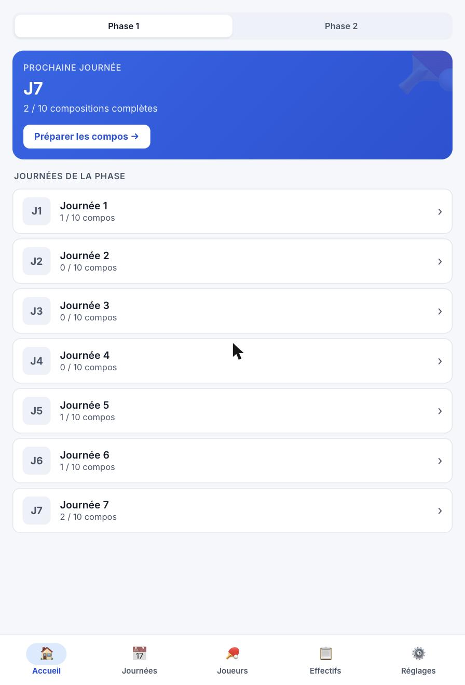
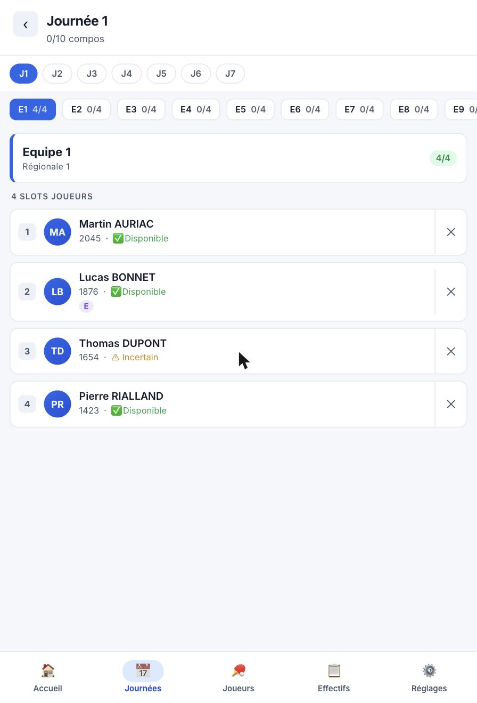
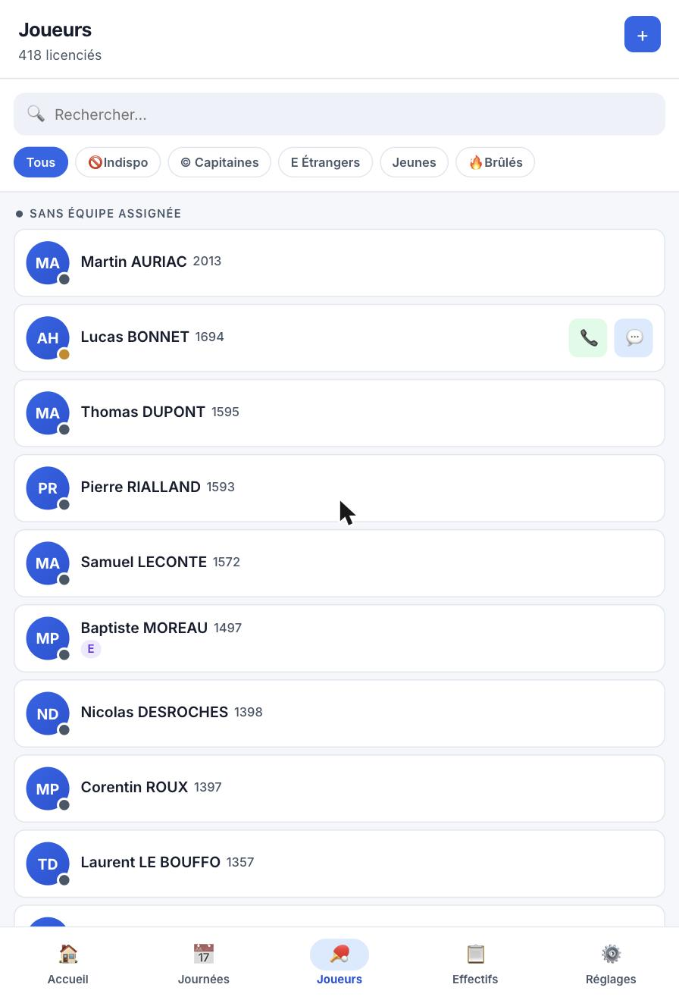
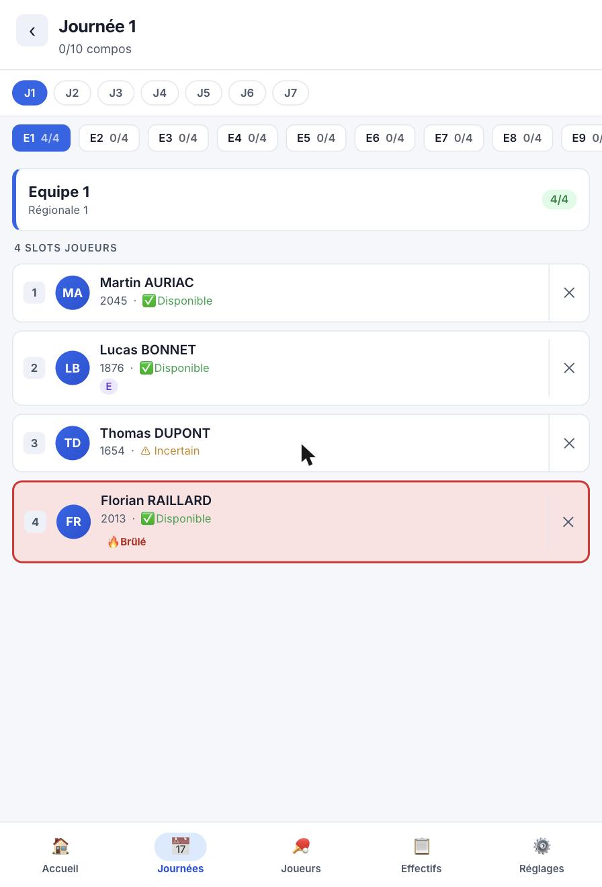

# TT Team Planner

> [!WARNING]
> **Ce plugin n'est plus maintenu.** La gestion des équipes est intégrée à [MonClubTT](https://github.com/robinos33/MonClubTT/releases/latest) depuis sa version 2.0.0 (PHP 8.4 requis), qui reprend toutes les données de TT Team Planner.
>
> **Migrer :**
> 1. Installer ou mettre à jour MonClubTT en 2.0.0 ou plus.
> 2. Désactiver TT Team Planner **sans le supprimer** : sa suppression efface ses données.
> 3. *Mon Club TT › Gestion des équipes › Import / export* : importer depuis TT Team Planner (ou depuis son fichier d'export JSON).
> 4. Vérifier l'application, renvoyer les liens magiques aux joueurs, puis supprimer TT Team Planner.

Plugin WordPress pour gérer les compositions d'équipes d'un club de **tennis de table** sur une saison de championnat par équipes.

Développé par l'**US Talence Tennis de Table** (Nouvelle-Aquitaine), il implémente les règles de brûlage FFTT en vigueur dans la ligue.

---

## Fonctionnalités

- 📋 **Compositions par journée** — assignation des 4 slots joueurs par équipe et par journée
- 🔥 **Brûlage en temps réel** — calcul automatique des règles 2 et 3 (FFTT II.112.1) à chaque saisie
- 🔮 **Brûlage projeté** — qui sera brûlé si les journées pas encore jouées se jouent comme composées
- 4️⃣ **Équipe complète en régional** — une équipe de PN à R3 à moins de 4 joueurs est signalée, en rouge dans la semaine de la journée
- ⓘ **Règles consultables depuis l'app** — le rappel des règles de brûlage et de qualification, sans accès au back-office
- 📅 **Disponibilités** — chaque joueur renseigne ses disponibilités (dispo / indispo / incertain) ; l'onglet **Dispos** de la vue Journée montre qui est dispo, placé ou sans réponse
- 👥 **Effectifs par phase** — ventilation des joueurs dans les équipes pour chaque demi-saison
- © **Capitaines** — un capitaine de phase par équipe, choisi dans l'effectif ; il est capitaine de chaque journée où il joue, sauf si un autre joueur de la compo est nommé pour cette journée-là
- 🔄 **Synchronisation FFTT** — import des licenciés depuis le plugin Mon Club TT
- 📱 **Application mobile (PWA)** — installable sur iOS et Android, fonctionne hors ligne
- 🌙 **Mode sombre** — thème clair/sombre

---

## Captures d'écran

| Tableau de bord | Compositions |
|:-:|:-:|
|  |  |

| Liste des joueurs | Joueur brûlé |
|:-:|:-:|
|  |  |

---

## Architecture

```
tt-team-planner/
├── tt-team-planner.php          # Point d'entrée WordPress
├── assets/
│   ├── js/app.js                # SPA vanilla JS (zéro dépendance)
│   ├── css/style.css            # Styles globaux
│   ├── manifest.json            # Manifeste PWA
│   └── service-worker.js        # Cache shell + API offline
└── includes/
    ├── Plugin.php               # Bootstrap & DI
    ├── Activator.php / Deactivator.php
    ├── Admin/
    │   ├── SettingsPage.php     # Interface de configuration
    │   └── SyncPage.php         # Synchronisation manuelle
    ├── Domain/
    │   ├── Player.php           # Entité joueur
    │   ├── BurnageChecker.php   # Règles de brûlage FFTT
    │   ├── BurnageStatus.php    # Résultat (ok / rule2 / rule3)
    │   ├── Availability.php
    │   ├── MatchAppearance.php
    │   ├── PhaseSquad.php
    │   └── TeamComposition.php
    ├── Repository/
    │   ├── MatchAppearanceRepository.php
    │   └── TeamCompositionRepository.php
    ├── Rest/
    │   ├── PlayersController.php         # GET /ttp/v1/players
    │   ├── AvailabilityController.php    # GET|POST /ttp/v1/availability
    │   ├── TeamsController.php           # GET|POST|DELETE /ttp/v1/compositions
    │   ├── PhaseSquadController.php      # GET|POST|DELETE /ttp/v1/phase-squads
    │   ├── MatchAppearanceController.php # GET|POST|DELETE /ttp/v1/appearances
    │   ├── SyncController.php            # POST /ttp/v1/players/sync
    │   └── SeasonController.php          # POST /ttp/v1/season/reset
    └── Front/
        ├── Assets.php                   # Enqueue + wp_localize_script
        └── StandaloneTemplate.php       # Template page standalone
```

### SPA côté client

L'interface est une **Single Page Application vanilla JS** (aucun framework, aucun build step) rendue dans `#ttp-app`. Elle fonctionne selon un cycle état → rendu → événement :

```
S (state)  →  render()  →  DOM
     ↑                        │
     └──── attachEvents() ←───┘
```

Le state (`S`) est un objet JS simple. Toute modification passe par `setState(patch)` qui déclenche un nouveau rendu.

---

## API REST

Base : `/wp-json/ttp/v1/`

| Méthode | Endpoint | Description |
|---------|----------|-------------|
| `GET` | `/players` | Liste de tous les licenciés |
| `GET` | `/players/{id}` | Détail d'un joueur |
| `PATCH` | `/players/{id}` | Mise à jour téléphone / notes |
| `POST` | `/players/sync` | Import depuis Mon Club TT (FFTT) |
| `GET` | `/availability` | Disponibilités `?season=&phase=` |
| `POST` | `/availability` | Déclarer une disponibilité |
| `GET` | `/compositions` | Compositions `?season=&phase=&round=` |
| `POST` | `/compositions` | Assigner un slot joueur |
| `DELETE` | `/compositions` | Retirer un joueur d'un slot |
| `POST` | `/compositions/captain` | Nommer le capitaine d'une journée, parmi les joueurs de la compo |
| `GET` | `/phase-squads` | Effectifs d'une phase |
| `POST` | `/phase-squads` | Affecter un joueur à une équipe |
| `DELETE` | `/phase-squads` | Retirer de l'effectif |
| `POST` | `/phase-squads/captain` | Nommer le capitaine de phase d'une équipe (`player_id` 0 : aucun) |
| `POST` | `/phase-squads/ventilate` | Ventilation automatique |
| `GET` | `/appearances/validate` | Statut de validation d'une journée |
| `POST` | `/appearances/validate` | Valider une journée (génère les apparences) |
| `DELETE` | `/appearances/validate` | Annuler une validation |
| `GET` | `/burnage` | Statut de brûlage pour une liste de joueurs, réel et projeté |
| `POST` | `/season/reset` | Réinitialisation d'une saison |

---

## Règles de brûlage (FFTT II.112.1)

Le plugin implémente les deux règles de brûlage applicables en championnat par équipes format 4 joueurs.

> Ces règles sont appliquées dans `BurnageChecker.php` en se basant sur les `MatchAppearance` (apparences validées) enregistrées en base.

### Règle 2 — Plafonnement par équipe

Un joueur ayant disputé **2 rencontres ou plus** au cours d'une phase dans une équipe de rang N (ou inférieur) **ne peut plus jouer dans une équipe de rang supérieur à N** pour le reste de la phase.

Le rang d'une équipe est déduit de son code (ex. `T1` → rang 1, `T3` → rang 3). Plus le numéro est petit, plus l'équipe est forte.

**Exemple :**
- J1 : Florian joue en Équipe 1 (T1)
- J2 : Florian joue en Équipe 2 (T2)
- J3 : le plafond est `max(rang joué) = 2` → Florian est brûlé pour toute équipe de rang > 2 → 🔥 ne peut plus jouer qu'en T1 ou T2

### Règle 3 — Limite J2 (montée de niveau)

À la **2e journée** d'une phase, une équipe ne peut aligner **plus d'un joueur** ayant joué la 1re journée dans une équipe de rang inférieur (plus forte).

**Exemple :**
- J1 : Luc joue en T1, Marc joue en T1
- J2 : si Luc est déjà aligné en T2, Marc ne peut pas l'être → ⚠ Limite J2

### Affichage dans l'UI

| Badge | Signification |
|-------|---------------|
| 🔥 Brûlé | Règle 2 déclenchée |
| ⚠ Limite J2 | Règle 3 déclenchée |
| 🔮 … si compos jouées | Brûlage projeté (voir ci-dessous) |
| Fond rouge + bordure épaisse | Joueur brûlé ou indisponible dans un slot |
| Fond orange + bordure épaisse | Joueur qui serait brûlé si les compos prévues se jouent |

Le statut est recalculé côté serveur après chaque modification de composition (invalidation du cache local + rechargement via `/burnage`).

Le bouton **ⓘ** de la vue Journée ouvre le rappel de toutes les règles : une version courte pour chacune, le texte complet sur demande. Les règles viennent de `Domain/QualificationRules`, qui alimente aussi le récapitulatif des réglages.

### Équipe complète (régional)

En Pré-Nationale, R1, R2 et R3, une équipe doit compter 4 joueurs ayant disputé au moins une partie (règlement régional LNATT, art. 4.6.2). À moins de 4, elle perd la rencontre (0 point) et paie 30 €. **Ce n'est pas un forfait** : le brûlage des joueurs présents se calcule normalement, et il ne faut pas déclarer de forfait dans l'application, sinon II.112.2 s'appliquerait à tort aux autres équipes.

| Situation | Affichage |
|-----------|-----------|
| Départementale, Pré-Régionale, niveau vide | `3/4` orange, comme avant |
| Régional, journée à plus de 6 jours | `3/4` orange et « 4 joueurs obligatoires » sous le niveau |
| Régional, à partir de J-6 | `3/4 · rencontre perdue` en rouge, ⚠ sur l'onglet de l'équipe, et sur l'image de partage |

Le niveau est lu depuis la saisie libre des réglages (`Domain/Division`), et `TTPConfig.teams[].full_team_required` le transmet au front. Déclarer un forfait pour une équipe dont la compo compte des joueurs demande une confirmation qui rappelle la différence.

### Brûlage projeté

Le brûlage réel ne compte que les journées **validées** (feuille FFTT importée ou validation manuelle). Pour préparer la J4 avant que la J3 soit jouée, l'application calcule aussi un brûlage **projeté** : les compositions des journées précédentes encore non validées y comptent comme si elles avaient été jouées.

- Un joueur brûlé pour de vrai garde son badge rouge. Un joueur qui ne le serait qu'en projection porte un badge orange 🔮 : c'est un avertissement, pas une interdiction.
- Une équipe validée à une journée garde ses rencontres enregistrées : la feuille fait foi sur la composition. Une équipe déclarée forfait ne projette rien.
- Modifier une composition met à jour la projection des journées suivantes.

Côté API, `/burnage` renvoie pour chaque joueur `burned`, `reason` et `detail` (journées validées seulement), et `projected` : `{reason, detail}` si le joueur n'est pas brûlé mais le serait en projection, sinon `null`.

---

## Prérequis

- PHP **8.2** ou supérieur
- WordPress **6.4** ou supérieur
- Plugin **[Mon Club TT](https://github.com/robinos33/MonClubTT)** pour la synchronisation des licenciés FFTT

---

## Installation

### Développement

```bash
cd wp-content/plugins
git clone <url-du-repo> tt-team-planner
cd tt-team-planner
composer install
```

Activer le plugin depuis l'interface WordPress, puis configurer les équipes dans **Réglages → TT Team Planner**.

### Production

Chaque [release GitHub](https://github.com/robinos33/tt-team-planner/releases) embarque un ZIP prêt à l'emploi (`tt-team-planner.zip`), déjà nettoyé des fichiers de dev (tests, composer, etc.).

1. Télécharger le ZIP de la dernière release.
2. Dans l'administration WordPress : **Extensions → Ajouter → Téléverser une extension**, sélectionner le ZIP, **Installer maintenant**.
3. Pour une mise à jour, réactiver après l'installation (WordPress propose de remplacer la version existante).

Alternative FTP/SSH : décompresser le ZIP dans `wp-content/plugins/`.

---

## Configuration

Depuis **WP Admin → TT Team Planner → Réglages** :

| Paramètre | Description |
|-----------|-------------|
| Nom du club | Affiché dans l'en-tête de l'app |
| Saison | Ex. `2024-2025` |
| Phase active | Phase 1 (sept–janv) ou Phase 2 (févr–juin) |
| Équipes | Code, nom, division, couleur pour chaque équipe |
| Dates des journées | 7 dates par phase |

---

## Export des données (JSON)

**WP Admin → TT Team Planner → Réglages → Export des données** télécharge un fichier `tt-team-planner-export-AAAA-MM-JJ-HHMMSS.json`, prévu pour être réimporté ailleurs (MonClubTT).

```jsonc
{
  "format": "tt-team-planner-export",
  "format_version": 1,
  "plugin_version": "1.6.1",
  "exported_at": "2026-11-13T10:00:00+00:00",   // UTC
  "site_url": "https://…/",
  "counts":  { "players": 463, "availabilities": 6, … },
  "options": { "ttp_club_name": "…", "ttp_teams": [ … ], "ttp_journee_dates_p1": [ … ], … },
  "tables": {
    "players": [ … ],            // raw_payload restitué en objet
    "availabilities": [ … ],
    "team_compositions": [ … ],
    "phase_squads": [ … ],
    "match_appearances": [ … ],
    "validated_rounds": [ … ],
    "team_forfeits": [ … ],
    "audit_log": [ … ]
  },
  "user_sms_templates": [        // SMS personnels (user meta)
    { "user_id": 1, "user_login": "…", "user_email": "…", "availability": "…", "confirmation": null }
  ]
}
```

- Chaque table est exportée ligne à ligne avec les colonnes SQL d'origine (colonnes numériques typées en entier, dates au format MySQL `Y-m-d H:i:s`).
- Les identifiants sont conservés : `player_id` renvoie à `players[].id`. À l'import, remapper les joueurs via `license_number` (ou `external_id`).
- `validated_by`, `declared_by` et `audit_log[].user_id` sont des ID utilisateurs WordPress du site source ; `user_sms_templates` donne aussi le login et l'e-mail pour retrouver le compte.
- Les liens magiques (`tttp_magic_links`) ne sont pas exportés.

---

## Application mobile (PWA)

L'application est installable sur mobile via le bandeau d'installation intégré :

- **Android / Chrome** : bouton "Installer" → prompt natif du navigateur
- **iOS / Safari** : instructions "⎙ Partager → Sur l'écran d'accueil"

Une fois installée, l'app fonctionne en mode **hors ligne** (cache shell CSS/JS + cache des dernières données API).

---

## Tests

```bash
# PHP
composer test

# PHP — unitaires uniquement
composer test:unit

# PHP — avec couverture
composer test:coverage

# JavaScript
npm install && npm test
```

---

## Licence

GPL v2 or later — voir [LICENSE](https://www.gnu.org/licenses/gpl-2.0.html)
